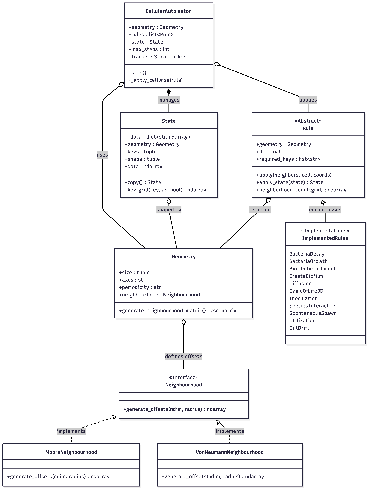
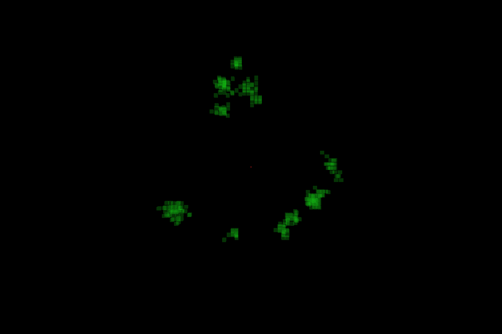

# Cellular Automata

A three-dimensional cellular automaton simulator for modelling bacterial populations, biofilm formation, microbial interactions, and transport processes. The project is designed for experiments involving bacterial dynamics in bioreactors, laboratory biofilm systems, and the human gut.

The simulator represents a spatial environment as a 3D grid. Each cell may contain bacterial species, biofilm attachment, floating bacteria, substrate concentrations, and other experiment-specific state variables. Configurable rules update the state over time, while an OpenGL renderer provides interactive visualization.


## Contents

- [Features](#features)
- [Architecture Overview](#architecture-overview)
- [Repository Structure](#repository-structure)
- [Configuration](#configuration)
- [Installation](#installation)
- [Running Simulations](#running-simulations)
- [Running Tests](#running-tests)
- [Authors](#authors)

## Features

- Three-dimensional cellular automaton grid with configurable grid dimensions and independent periodicity per axis.
- Handling of multiple bacterial species.
- Biofilm and floating-bacteria state variables.
- Rule-based simulation architecture with configurable rule-specific time steps.
- Species interaction rules.
- Biofilm detachment rules.
- Spontaneous bacterial spawning.
- Support for multi-layer variables such as substrates.
- Bacterial drift and transport.
- JSON-based configuration.
- OpenGL and GLFW visualization and headless simulation mode.

## Architecture Overview




### Geometry

`Geometry` defines the spatial domain and boundary behavior.

It handles:

- Grid dimensions.
- Axis ordering.
- Periodic boundaries.
- Neighbor and offset calculations.
- Spatial indexing.

The `periodicity` setting specifies which axes wrap around:

- `"xyz"` — all axes are periodic.
- `"xy"` — x and y are periodic; z has boundaries.
- `"z"` — only z is periodic.
- `""` — all axes are non-periodic.

### State

`State` stores values associated with every grid cell. State variables are stored as separate NumPy arrays in an internal dictionary.

Typical keys include:

- Bacterial species names.
- `biofilm`.
- `floating_bacteria`.
- Substrate variables.
- Experiment-specific fields.

Prefer accessing individual variables:

```python
bacteria = state["Bacteroidaceae"]
state["biofilm"] = biofilm
```

The combined `state.data` property should be used carefully because it stacks variables and expands multi-layer values. Individual keys preserve each variable's data type and layer structure.

### Multi-layer State Variables

Some variables, such as substrates, can contain multiple layers. Layer counts are configured through `key_layers` or the `State` constructor.

A multi-layer variable may have a shape conceptually equivalent to:

```text
(x, y, z, layers)
```

Code operating on state data should account for this additional trailing dimension.

### Rules

Rules are independent processes that modify the simulation state. Each rule can have its own time step and parameters.

Examples include:

- `biofilm_detachment`
- `species_interaction`
- `spontaneous_spawn`
- `gut_drift`

Rules are configured in JSON and executed by the cellular automaton when their scheduled time step is reached.

### Cellular Automaton

The cellular automaton coordinates:

1. Loading the current state.
2. Determining which rules are due.
3. Applying the rules.
4. Updating state variables.
5. Advancing simulation time.
6. Invoking callbacks or rendering.

### Renderer

The renderer uses GLFW and OpenGL to display the simulation in three dimensions.

It supports:

- 3D visualization.
- Shader-based rendering.
- Transparency.
- Order-independent transparency using framebuffer ping-pong.
- Interactive camera controls.

Controls:

- P: advance the simulation.
- W/S: move the camera towards/away from the centre of the grid (zoom).
- A/D: move the camera left/right around the centre (orbit).
- Q/E: move the camera up/down around the centre (orbit).
- C: toggle cross-section mode.
- J/L: move the cross-section layer down/up.
- X: cycle the cross-section axis.
- G: save the frames captured so far as a GIF (only in `examples/generate_gif.py`).
- Esc: close the window.



## Repository Structure

```text
.
├── src/cellular_automata/     # the simulation library (installable package)
│   ├── Geometry.py, State.py, Sim.py, Rule.py, Callback.py, Neighbourhood.py
│   ├── neighbourhoods/        # Moore / von Neumann neighbourhoods
│   ├── rules/                 # one file per rule (BacteriaGrowth, Diffusion, GutDrift, ...)
│   ├── rendering/             # OpenGL renderer, camera, shaders/
│   ├── tracking/              # StateTracker: saves simulation state to .npz
│   ├── config/Parser.py       # builds a simulation from a JSON config
│   └── util/
├── configs/examples/          # small, ready-to-run example configs
├── examples/                  # runnable scripts (rendered / headless runs, replay, GIF export)
│   └── notebooks/
├── research/                  # study-specific work, one folder per study
│   ├── bioreactor/            # configs/, data/, notebooks/, scripts/
│   └── gut/                   # gut microbiome study
├── tools/profiling/           # CPU / RAM monitoring and cProfile helpers
├── tests/
├── docs/assets/               # images used in this README
└── pyproject.toml
```

Generated output (tracked simulations, GIFs, profiles) is written to `output_files/`, which is git-ignored.

Experiment results are not kept on the code branches. Scripts write them to `research/<study>/results/`, which is git-ignored. Results worth keeping are archived on the orphan [`results`](https://github.com/MaruStalmach/Cellular-Automata/tree/results) branch, together with the commit and config that produced them.

### Adding new things

- **A new rule** - add a module to `src/cellular_automata/rules/` with a `Rule` subclass decorated with `@register_rule` (from `cellular_automata.registry`). Every module in that folder is imported automatically, so configs can refer to the rule by class name; no other file needs editing. A config naming an unregistered rule fails with `Unknown rule '<name>'` and the list of known rules.
- **A new neighbourhood** - the same, in `src/cellular_automata/neighbourhoods/` with `@register_neighbourhood`.
- **A new study** - create `research/<study>/` with the same `configs/`, `data/`, `notebooks/`, `scripts/` layout as `research/bioreactor/`. Archive its results on the `results` branch.
- **A new example config** - add it to `configs/examples/`.

## Configuration

Simulations are configured with JSON files and built by `cellular_automata.config.Parser.parse_json`. A configuration has these sections:

| Section | Required | Contents |
|---|---|---|
| `sim` | yes | `size`, `periodicity` (axes that wrap around, e.g. `"xy"`), `max_steps`, `render`; optional `neighbourhood` (`MooreNeighbourhood` by default), `dtype` and `seed` (see [Reproducibility](#reproducibility)) |
| `state_keys` | yes | One entry per state variable: `name`, `layers`, `dtype`, and optional random initialisation (`random`, `random_func`, `random_args`) |
| `rules` | yes | One entry per rule: `name` (the rule class) and `args` (constructor arguments; every rule needs `time_step`) |
| `tracker` | no | Records the state each step and saves it to `output_files/tracked_simulations/<save_as>.npz` at `max_steps` |
| `renderer` | when `render` is true | `key` to display, `window_size`, and an optional `callback` (`Callback`, `ReduceCallback`, `MultiKeyCallback`) with `args` |

Example configuration:

```json
{
  "sim": {
    "size": [50, 50, 20],
    "periodicity": "xy",
    "render": false,
    "max_steps": 50
  },
  "state_keys": [
    {
      "name": "substrate",
      "layers": 6,
      "dtype": "np.uint8",
      "random": true,
      "random_func": "np.random.choice",
      "random_args": {"a": [0, 1], "p": [0.999, 0.001]}
    },
    {
      "name": "bacteria",
      "layers": 1,
      "dtype": "np.uint8",
      "random": true,
      "random_func": "init_block",
      "random_args": {"start": [25, 25, 0], "block_size": [3, 3, 3], "value": 1}
    }
  ],
  "rules": [
    {
      "name": "Diffusion",
      "args": {"time_step": 0.01, "target_key": "substrate", "a": 7.4, "p": 0.07}
    },
    {
      "name": "Utilization",
      "args": {"time_step": 0.01, "bacteria_keys": ["bacteria"], "substrate_key": "substrate"}
    },
    {
      "name": "BacteriaGrowth",
      "args": {"time_step": 43200, "bacteria_keys": ["bacteria"], "substrate_key": "substrate"}
    }
  ],
  "tracker": {"name": "StateTracker", "args": {}, "save_as": "readme_example"},
  "renderer": {"key": "bacteria", "window_size": [1200, 800]}
}
```

More examples are in `configs/examples/` and `research/bioreactor/configs/`.

### Time model

Each rule has its own `time_step` (`dt`), and one simulation step lasts as long as the **largest** `dt` among the rules:

- During one step, each rule runs `floor(max_dt / dt)` times, **clipped to the range 1 to 500**.
- The runs are interleaved round-robin in the order the rules appear in the config, so rule order matters.

For example, with `Diffusion` at `dt = 0.01` and `BacteriaGrowth` at `dt = 43200`, the ratio would be 4,320,000, but diffusion runs only 500 times per step. The cap is not reported, so keep it in mind when choosing time steps (tracked as BUG-5 in `docs/code-quality-plan.md`).

### Reproducibility

Set `sim.seed` to a non-negative integer to make a run repeatable: the same config and seed give the same initial state and the same random draws in every rule. Without a seed, the parser picks one, reports it in a warning, and the tracker stores it in the saved `.npz` metadata, so any tracked run can be repeated afterwards.

- Initial state: `random_func: "np.random.<method>"` draws from the seeded generator, so the method must exist on `np.random.Generator` (use `np.random.integers`, not `np.random.randint`). Helper functions such as `random_seeds` get the generator through their `rng` argument.
- Rules: each rule gets its own generator, `self.rng`, derived from the seed and the rule's position in the config. Adding a rule at the end doesn't change the earlier rules' streams; inserting or reordering rules changes the streams of the rules after that point. A rule built outside a simulation has an unseeded `self.rng`. Draw from `self.rng` in new rules, never from `np.random`.

## Installation

### Requirements

- Python 3.12.
- An OpenGL-compatible display and GLFW-compatible graphics support for rendered simulations.

### Setup

With [uv](https://docs.astral.sh/uv/):

```bash
uv sync                      # library + dev tools (pytest, ruff)
uv sync --extra research     # also install pandas, imageio, psutil for examples/research/tools
```

Or with pip:

```bash
pip install -e ".[research]"
```

## Running Simulations

Run commands from the repository root (prefix them with `uv run` when using uv).

### Rendered Simulation

```bash
python examples/CA_sim.py -f configs/examples/draft.json
```

The renderer opens an interactive window. Press **P** to advance the simulation.
Configs with `"render": false` in their `sim` section run headless with the same command.

Config paths are resolved relative to the current directory, so research configs work the same way:

```bash
python examples/CA_sim.py -f research/bioreactor/configs/full18.json
```

### Headless Simulation

```bash
python examples/sim_no_render.py -x 20 -y 20 -z 20 -s 100
```

Arguments:

| Argument | Description |
|---|---|
| `-x` | Grid size along the x axis. |
| `-y` | Grid size along the y axis. |
| `-z` | Grid size along the z axis. |
| `-s` | Number of simulation steps. |

Headless mode is useful for:

- Automated experiments.
- Parameter sweeps.
- Performance testing.
- Remote machines.
- Systems without a graphical display.

### Replaying and Exporting

Configs with a `tracker` section save their state to `output_files/tracked_simulations/<save_as>.npz`, which can be replayed or exported:

```bash
python examples/CA_sim.py -f configs/examples/demo.json          # writes output_files/tracked_simulations/demo.npz
python examples/Replay_sim.py -f demo -k bacteria substrate
python examples/generate_gif.py -f demo -k bacteria --duration 8  # writes output_files/gifs/demo.gif
```

## Running Tests

```bash
uv run pytest        # or: python -m pytest
```

## Authors

This repository was developed as a Master's research and software project for modelling bacterial and biofilm dynamics.

- **Authors:** Maria Stalmach, Jakub Wojciechowski
- **Institution:** AGH University of Science and Technology

